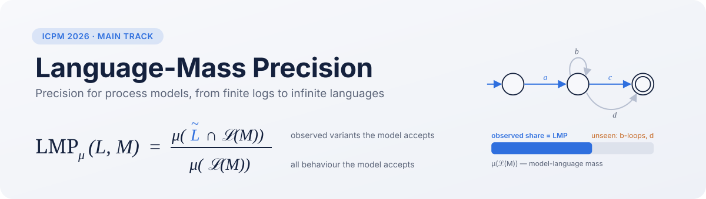
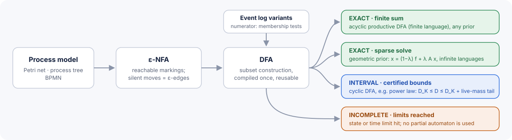

<p align="center">
  
</p>

<p align="center">
  <a href="#citation"></a>
  <a href="https://github.com/sbarbonjr/language-mass-precision/actions/workflows/tests.yml"></a>
  
  <a href="https://pm4py.fit.fraunhofer.de/"></a>
  <a href="LICENSE"></a>
</p>

<p align="center">
  <a href="#installation">Installation</a> ·
  <a href="#quickstart">Quickstart</a> ·
  <a href="#how-it-works">How it works</a> ·
  <a href="#tutorials">Tutorials</a> ·
  <a href="#api-at-a-glance">API</a> ·
  <a href="#citation">Citation</a>
</p>

---

**`language-mass-precision`** is the reference implementation of **Language-Mass Precision (LMP)**, a precision measure for process mining that compares the *language* of a process model with the variants observed in an event log:

$$
\mathrm{LMP}_\mu(L, M) \;=\; \frac{\mu\big(\tilde L \cap \mathcal L(M)\big)}{\mu\big(\mathcal L(M)\big)}
$$

$\tilde L$ is the set of distinct log variants, $\mathcal L(M)$ the model language, and $\mu$ a fixed, full-support probability mass over all traces $\Sigma^*$. LMP is the share of the model language's mass that the log supports. Because $\mu$ is a probability measure, the quotient is well defined even when loops make $\mathcal L(M)$ infinite. The masses are a declared reference measure. They are not empirical frequencies and not a stochastic model of the process.

The library plugs into PM4Py. It takes PM4Py logs and models, follows PM4Py's `algorithm.apply(..., variant=, parameters=)` convention, and also offers a scikit-learn style estimator for prior sweeps and model ranking.

> [!NOTE]
> **News · Nov 2026.** *Language-Mass Precision: A Measure-Theoretic View of Finite Logs and Infinite Model Languages* has been accepted at the **ICPM 2026 main track**.

## Highlights

- **Language-level.** LMP depends only on $\mathcal L(M)$, so silent transitions, duplicate labels and dead branches that leave the language unchanged leave the score unchanged. It satisfies the precision axioms of Tax et al.
- **Exact on infinite languages.** Models are compiled to a DFA. The denominator is then a finite sum, an exact sparse linear solve, or a certified interval, never an unchecked truncation.
- **Honest about failure.** Every result carries a status (`exact`, `interval`, `bounded`, `incomplete`, `undefined`), so an approximation is never reported as a value.
- **Explainable.** LMP is additive over traces: each unseen accepted trace owns an exact share of $1-\mathrm{LMP}$, and the library lists the heaviest ones.
- **PM4Py-native.** It accepts DataFrames, `EventLog`s, Petri nets, process trees and BPMN, and has both a PM4Py-style and a scikit-learn-style interface.
- **Fast sweeps.** Compile a model once, then score it under any prior in milliseconds.

## Installation

```bash
pip install language-mass-precision               # once released on PyPI
pip install "language-mass-precision[tutorials]"  # + jupyter, matplotlib, scikit-learn
```

From source:

```bash
git clone https://github.com/sbarbonjr/language-mass-precision.git
cd language-mass-precision
pip install -e ".[dev,tutorials]"
```

Requires Python ≥ 3.10 and PM4Py ≥ 2.7.

## Quickstart

```python
import pm4py
import language_mass_precision as lmp

log = [("a", "b", "c"), ("a", "d", "c"), ("a", "b", "c")]        # or a PM4Py DataFrame / EventLog
model = pm4py.parse_process_tree("->('a', X('b', 'd', 'e'), 'c')")  # or (net, im, fm), or BPMN

lmp.precision_language_mass(log, model)
# LMPResult(status=exact, value=0.666667, certification='full_language_finite_sum')
```

The model admits `a e c`, which the log never shows. All three traces have the same length and therefore the same prior mass, so LMP is exactly 2/3.

Several models can be ranked under one shared prior:

```python
models = {
    "exact":   pm4py.parse_process_tree("->('a', X('b', 'd'), 'c')"),
    "extra_e": model,
    "loop":    pm4py.parse_process_tree("->('a', *(X('b', 'd'), tau), 'c')"),
    "flower":  pm4py.parse_process_tree("*(tau, X('a', 'b', 'c', 'd', 'e'))"),
}
lmp.rank_models(log, models, length_prior="power_law")
```

```
  model  rank   status    value    lower    upper            certification
  exact     1    exact 1.000000 1.000000 1.000000 full_language_finite_sum
   loop     2 interval      NaN 0.696596 0.696597   deterministic_interval
extra_e     3    exact 0.666667 0.666667 0.666667 full_language_finite_sum
 flower     4 interval      NaN 0.000703 0.000740   deterministic_interval
```

You can also see which unseen behaviour costs the most precision:

```python
lmp.imprecision_attribution(log, models["loop"], top_k=3)
```

```
          trace  imprecision_share
   (a, b, b, c)           0.060918
   (a, b, d, c)           0.060918
   (a, d, b, c)           0.060918
```

### Reading a result

| `status` | meaning | numbers available |
|---|---|---|
| `exact` | full-language value, computed exactly | `value` (= `lower` = `upper`) |
| `interval` | certified interval that contains the full-language value | `lower`, `upper`, `width`, `midpoint` |
| `bounded` | playout baseline over traces of length ≤ K, no certificate | `value`, `truncation_k` |
| `incomplete` | state or time limit reached while compiling | `reason` |
| `undefined` | empty model language | `reason` |

`float(result)` returns the value only when there is one; on an interval it raises rather than silently pick a point. `result.certainly_greater(other)` tells whether two certified intervals prove an ordering. `result.to_dict()` gives a flat record for DataFrames.

## How it works

<p align="center">
  
</p>

1. **Compile.** The reachable markings of the Petri net form an ε-NFA. Silent transitions are ε-edges and duplicate labels are ordinary nondeterminism. Subset construction gives a DFA. Both phases are bounded by `state_limit` and `time_limit`, and when a limit is hit the result is `incomplete`, never a partial automaton.
2. **Numerator.** Membership tests for the finitely many log variants, with masses summed in log space. Variant frequencies do not enter LMP.
3. **Denominator** $D = \mu(\mathcal L(M)) = \sum_n \rho_n\, p_n$, where $p_n$ is the activity-prior mass of accepted traces of length $n$:
   - *finite sum* when the productive DFA is acyclic (finite language), for any prior;
   - *sparse solve* $x = (1-\lambda) f + \lambda A x$ for the geometric prior, exact even when the language is infinite;
   - *certified interval* otherwise: $D_K \le D \le D_K + s_{K+1}\sum_{n>K}\rho_n$, where $s_{K+1}$ is the prior mass still on productive DFA states after $K{+}1$ symbols. This *live-mass* bound shrinks as the model language thins out, so cyclic models typically certify at $K \approx 10$–$40$ with relative width $10^{-6}$.

The alphabet $\Sigma$ is the union of the log activities and the labels that occur in the model language. Labels on dead branches are excluded, so language-equivalent models always share a prior. `rank_models` (or a declared `alphabet=`) keeps $\Sigma$ fixed across a group of models, which is what makes their scores comparable.

## Priors

The prior factorizes into a length prior $\rho$ and an activity prior $\pi$: $\mu(\langle a_1,\dots,a_n\rangle) = \rho_n\prod_i \pi(a_i)$.

| `length_prior` | $\rho_n$ | `length_parameter` | default calibration |
|---|---|---|---|
| `"geometric"` | $(1-\lambda)\lambda^n$ | $\lambda \in (0,1)$ | $\lambda_{50} = 2^{-1/(\ell_{50}+1)}$ |
| `"power_law"` | $(n+1)^{-\alpha}/\zeta(\alpha)$ | $\alpha > 1$ | solve $\sum_{n\le\ell_{50}}\rho_n = 1/2$ |

| `activity_prior` | $\pi(a)$ |
|---|---|
| `"uniform"` (default) | $1/\lvert\Sigma\rvert$ |
| `"empirical"` | $(c(a)+\delta)/(N+\delta\lvert\Sigma\rvert)$, with `laplace_delta` $=\delta$ |
| a mapping | any full-support distribution over $\Sigma$ |

With `length_parameter=None` the prior is calibrated so that half its mass lies on traces no longer than the median variant length $\ell_{50}$ of the log. Custom length priors can be plugged in by subclassing `LengthPrior`.

The prior is part of the metric and should be fixed before comparing models. For nested model languages the LMP ordering holds under every prior. For incomparable languages the prior can legitimately change the ranking, and [tutorial 03](tutorials/03_priors_and_sensitivity.ipynb) shows both cases.

## API at a glance

**Simplified functions**, in the style of `pm4py.precision_alignments`:

| function | returns |
|---|---|
| `precision_language_mass(log, *model, **params)` | `LMPResult` |
| `rank_models(log, models, **params)` | `DataFrame`, one row per model, shared prior |
| `imprecision_attribution(log, *model, top_k=10, **params)` | `DataFrame` of the heaviest unseen traces |
| `compile_model(*model, state_limit=, time_limit=)` | `CompiledModel` (DFA), reusable across logs and priors |

**Estimator**, following scikit-learn conventions (`get_params`/`set_params`, and it works with `sklearn.base.clone` and `ParameterGrid`; scikit-learn itself is not a dependency):

```python
est = lmp.LanguageMassPrecision(length_prior="power_law", activity_prior="uniform")
est.fit(log)                                  # variants_, alphabet_, median_length_, n_cases_
compiled = est.compile(net, im, fm)           # the expensive step, done once
est.score(compiled)                           # LMPResult
est.set_params(length_parameter=3.0).score(compiled)   # cheap re-score, no recompilation
est.score_many({"m1": m1, "m2": m2})          # ranking DataFrame
est.attribution(compiled, top_k=10)
```

**PM4Py algorithm interface:**

```python
from language_mass_precision.algo.precision import algorithm as lmp_algorithm

lmp_algorithm.apply(log, net, im, fm,
                    variant=lmp_algorithm.Variants.EXACT,        # or Variants.PLAYOUT
                    parameters={lmp_algorithm.Parameters.LENGTH_PRIOR: "power_law",
                                lmp_algorithm.Parameters.ACTIVITY_KEY: "concept:name"})
```

<details>
<summary><b>All hyperparameters</b></summary>

| parameter | default | description |
|---|---|---|
| `length_prior` | `"geometric"` | `"geometric"`, `"power_law"` or a `LengthPrior` instance |
| `length_parameter` | `None` | λ or α; `None` calibrates from the median variant length |
| `activity_prior` | `"uniform"` | `"uniform"`, `"empirical"` or a mapping |
| `laplace_delta` | `1.0` | smoothing for the empirical activity prior |
| `alphabet` | `None` | declared Σ, merged with the log activities |
| `method` | `"exact"` | `"exact"` (full language) or `"playout"` (bounded baseline) |
| `max_trace_length` | `10` | K for the playout baseline |
| `state_limit` | `200000` | reachability/DFA state budget |
| `time_limit` | `120.0` | compilation time budget (seconds) |
| `width_tolerance` | `1e-6` | target relative width of certified intervals |
| `max_k` | `4096` | largest truncation length for intervals |
| `activity_key`, `case_id_key`, `timestamp_key` | PM4Py defaults | column / attribute names |

</details>

## Tutorials

Executed notebooks with outputs are in [`tutorials/`](tutorials/):

| notebook | what it covers |
|---|---|
| [01 · Quickstart](tutorials/01_quickstart.ipynb) | first scores, input formats, the three interfaces, reading `LMPResult` |
| [02 · Controlled examples](tutorials/02_controlled_examples.ipynb) | the precision axioms on toy cases: fitness vs precision, inclusion with decoys, flower model, language equivalence, log extension |
| [03 · Priors and sensitivity](tutorials/03_priors_and_sensitivity.ipynb) | calibration, prior sweeps with `ParameterGrid`, ranking stability vs legitimate reversals, the activity prior, certified ordering |
| [04 · Infinite languages](tutorials/04_infinite_languages_and_certification.ipynb) | loops, exact vs certified vs incomplete, exact vs bounded playout (truncation error and cost) |
| [05 · Imprecision attribution](tutorials/05_imprecision_attribution.ipynb) | which unseen traces make a model imprecise |
| [06 · Discovery workflow](tutorials/06_pm4py_discovery_workflow.ipynb) | discovery with PM4Py, LMP against token/alignment precision, explaining disagreements |

Standalone scripts are in [`examples/`](examples/): `quickstart.py`, `prior_sweep.py` and `rank_discovered_models.py <log.xes>`.

## Toy datasets

`lmp.datasets.load_toy(name)` returns PM4Py DataFrames and `(net, im, fm)` triples with known language relations:

| name | logs | models | illustrates |
|---|---|---|---|
| `precision_fitness` | 1 | `smaller`, `exact`, `larger` | precision is independent of fitness |
| `decoy_stress` | 1 | `with_decoys`, `larger` | inclusion respected despite dead visible branches |
| `flower` | 1 | `constrained`, `flower` | overgeneralization |
| `silent_routing` | 1 | `direct`, `silent` | invariance under language equivalence |
| `log_extension` | `L1 ⊂ L2 ⊂ L3` | `choice` | adding fitting behaviour raises LMP |

## Validation

- **Test suite.** 41 tests cover the exact engine, the axioms on the toy cases, input formats, the estimator protocol and scikit-learn compatibility (`pytest`).
- **Agreement with the paper's pipeline.** On the real-log models of the paper (Sepsis Cases and Road Traffic Fine Management), the geometric-prior values reproduce the archived ones to a relative error below $4\cdot10^{-15}$. The power-law intervals overlap the archived intervals in all cases. The live-mass bound narrows them from widths of up to 0.99 to about $10^{-7}$, at $K \le 39$ against $K = 4096$ before.

## Project layout

```
src/language_mass_precision/
├── __init__.py              # public API: import language_mass_precision as lmp
├── simplified.py            # precision_language_mass, rank_models, imprecision_attribution, compile_model
├── estimator.py             # LanguageMassPrecision (scikit-learn conventions)
├── algo/
│   ├── conversion/to_automaton.py    # Petri net → ε-NFA → DFA (bounded)
│   ├── denominator.py                # finite sum · sparse solve · certified interval
│   ├── precision/algorithm.py        # PM4Py-style apply(), Variants, Parameters
│   ├── precision/variants/exact.py   # full-language LMP
│   ├── precision/variants/playout.py # bounded-playout baseline
│   └── attribution.py                # best-first search for heaviest unseen traces
├── objects/                 # DeterministicAutomaton, priors, LMPResult, CompiledModel, Status
├── utils/                   # log and model adapters
└── datasets/                # bundled toy examples
tests/  tutorials/  examples/  docs/assets/
```

## Development

```bash
pip install -e ".[dev,tutorials]"
pytest                      # unit and axiom tests
ruff check src tests        # lint
jupyter nbconvert --to notebook --execute tutorials/*.ipynb --output-dir /tmp/nb   # run the tutorials
```

See [CONTRIBUTING.md](CONTRIBUTING.md) for conventions.

## Reproducibility

The controlled evaluation and the real-log experiments of the ICPM paper are archived in a separate repository, [`lmp-controlled-evaluation`](https://github.com/paoloceravolo/lmp-controlled-evaluation). That package is frozen with the paper; this library is where LMP keeps evolving.

## Citation

If you use LMP, please cite:

```bibtex
@inproceedings{ceravolo2026lmp,
  title     = {Language-Mass Precision: A Measure-Theoretic View of Finite Logs and Infinite Model Languages},
  author    = {Ceravolo, Paolo and Maghool, Samira and Barbon Junior, Sylvio},
  booktitle = {Proceedings of the International Conference on Process Mining (ICPM 2026)},
  year      = {2026}
}
```

The same entry is available as `lmp.CITATION` and in [`CITATION.cff`](CITATION.cff).

## Authors

- **Paolo Ceravolo**, University of Milan, Department of Computer Science
- **Samira Maghool**, Pegaso University, Department of Information Science and Technology
- **Sylvio Barbon Junior**, University of Trieste, Department of Engineering and Architecture

## License

Apache License 2.0, see [LICENSE](LICENSE). LMP depends on [PM4Py](https://github.com/pm4py/pm4py), which is distributed under AGPL-3.0; check its terms for your use case.
